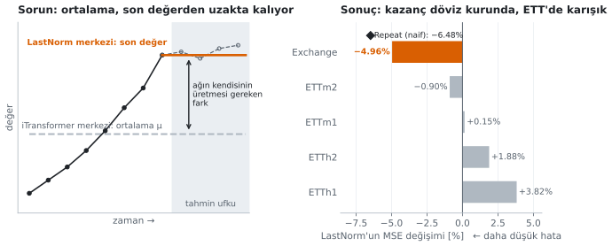
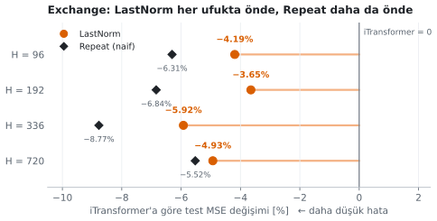
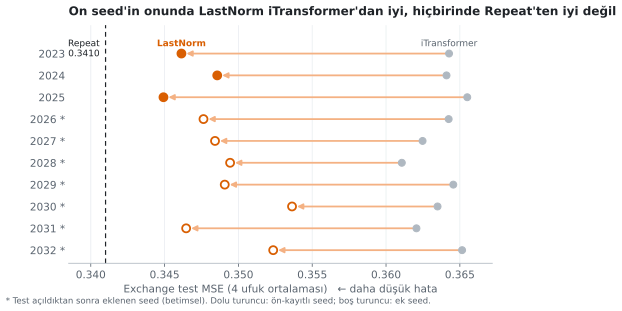
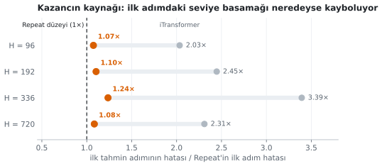
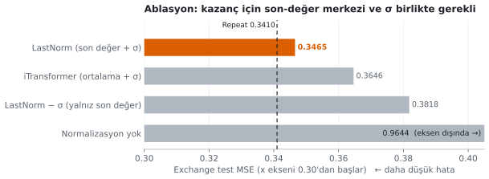
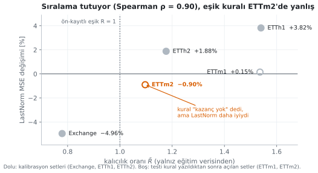

# LastNorm-iTransformer

**Normalizasyon Merkezini Son Gözleme Taşımak iTransformer'ı İyileştirir mi? Döviz Kurunda Kazanç, Diğer Veri Setlerinde Karışık Sonuç**

**Tuğrulhan Karslı**¹ (sorumlu yazar) · **Ufuk Asıl**¹ (danışman)
¹ Ostim Teknik Üniversitesi, Ankara

Bu depo makaledeki deneylerin **kodunu, yapılandırmalarını ve koşum kayıtlarını** içerir. Makale dergiye gönderilmek üzere hazırlanıyor ve henüz yayımlanmadı.

<p align="center">
  <picture>
    <source media="(prefers-color-scheme: dark)" srcset="docs/figures/hero-dark.svg">
    
  </picture>
</p>

> **Tek cümleyle:** iTransformer'ın girdiyi ölçeklerken kullandığı merkezi *pencere ortalamasından* *son gözleme* taşıdık. Döviz kurunda hata **%4.96 azaldı**, ama "yarın bugünkü gibi" diyen naif tahmin (Repeat) **yine daha iyiydi**. ETT veri setlerinde sonuç karışık çıktı.

---

## İçindekiler

1. [Bir bakışta](#bir-bakışta)
2. [Sorun: neden ortalama yanlış yerde olabilir?](#sorun-neden-ortalama-yanlış-yerde-olabilir)
3. [Yöntem: tek satırlık değişiklik](#yöntem-tek-satırlık-değişiklik)
4. [Sonuçlar](#sonuçlar)
5. [Bu sonuçlara neden güvenebilirsiniz?](#bu-sonuçlara-neden-güvenebilirsiniz)
6. [Elenen hipotezler](#elenen-hipotezler)
7. [Sınırlılıklar](#sınırlılıklar)
8. [Depo yapısı](#depo-yapısı)
9. [Kurulum ve yeniden üretim](#kurulum-ve-yeniden-üretim)
10. [README grafikleri](#readme-grafikleri)
11. [Veri, lisanslar ve atıf](#veri-lisanslar-ve-atıf)
12. [English summary](#english-summary)

---

## Bir bakışta

| | |
|---|---|
| **Soru** | iTransformer'da normalizasyon merkezini pencere ortalaması (μ) yerine son gözlem yapmak hatayı azaltır mı? |
| **Değişiklik** | Yalnız merkez. Ölçek (σ), omurga, hiperparametreler, epoch'lar ve seed'ler resmî iTransformer ile aynı. **Yeni parametre yok.** |
| **Ana sonuç (Exchange-Rate)** | Test MSE 0.3646 → **0.3465** (**−4.96%**, Holm *p* = 0.0129). Dört ufkun dördünde, sonradan eklenen seed'lerle **on seed'in onunda** daha iyi. |
| **Ama** | Naif Repeat 0.3410 ile **hâlâ daha iyi**. LastNorm hiçbir seed ve ufukta Repeat'in altına inmedi. |
| **Diğer veri setleri** | ETTm2 −0.90%, ETTm1 +0.15% (ayırt edilemez), ETTh2 +1.88%, ETTh1 +3.82%. |
| **Protokol** | Rakip önce literatür değerlerine yeniden üretildi; seçim **ön-kayıtlı kuralla** yalnız doğrulama verisinde yapıldı; test **bir kez** açıldı; ayar test sonucuna göre değiştirilmedi. |
| **Pratik ders** | Son-değer merkezi sabit bir varsayılan olarak benimsenmemeli; hedef veride **iTransformer ve Repeat ile birlikte** sınanmalı. |

Bütün sayılar test bölümüne, z-ölçekli MSE'ye ve aksi belirtilmedikçe **dört ufuk (H = 96, 192, 336, 720) ve 3 seed (2023, 2024, 2025) ortalamasına** aittir.

---

## Sorun: neden ortalama yanlış yerde olabilir?

Zaman serisi modelleri her geçmiş pencereyi önce kendi içinde ölçekler (örnek-içi normalizasyon): her değişkenden bir **merkez** çıkarılır, bir **ölçeğe** bölünür, ağın çıktısı ters işlemle geri çevrilir. iTransformer'da merkez **pencere ortalamasıdır**.

Kur pencere içinde yükseldiyse ortalama, son değerin **altında** kalır. Bu durumda ağ hiçbir şey öğrenmeden sıfır çıktı verirse tahmin "gelecek, geçmişin ortalaması olacak" olur. Son değere yakın bir tahmin verebilmek için ağın aradaki farkı **her adımda kendisinin üretmesi** gerekir. Bu fark üretilemezse ilk adımda bir **seviye basamağı** oluşur ve bu basamak bütün tahmin ufkuna taşınır.

Döviz kurları rastgele yürüyüşe yakındır. Bu yüzden yarının en iyi tahmini çoğu zaman bugünün değeridir (Meese ve Rogoff, 1983). Nitekim Exchange-Rate verisinde naif "son değeri tekrarla" tahmini (**Repeat**), Transformer tabanlı modellerin hepsinden daha düşük hata verir (Zeng vd., 2023). Son değeri girdisinde zaten gören bir modelin bu tahminin gerisinde kalması bizi şu soruya götürdü: **sorun, modelin veriyi hangi merkeze göre ölçeklediğinde olabilir mi?**

---

## Yöntem: tek satırlık değişiklik

Her pencere ve değişken *c* için:

| | Merkez *m*<sub>c</sub> | Ölçek *s*<sub>c</sub> | Ağ sıfır çıktı verirse tahmin |
|---|---|---|---|
| **iTransformer (resmî)** | pencere ortalaması μ<sub>c</sub> | pencere std σ<sub>c</sub> | pencere ortalaması |
| **LastNorm** | son gözlem *x*<sub>L,c</sub> | pencere std σ<sub>c</sub> | son değer = **Repeat** |

Girdi `(x − m) / s` ile normalize edilir, çıktı `s · ağ(·) + m` ile geri çevrilir. Böylece ağ **naif tabanın üzerine bir düzeltme** öğrenir. Kodda değişen tek şey merkezdir ([`varyantlar/lastnorm/model_lastnorm.py`](varyantlar/lastnorm/model_lastnorm.py)):

```python
# Resmî iTransformer (Non-stationary Transformer normalizasyonu, afinsiz):
means = x_enc.mean(1, keepdim=True).detach()
stdev = torch.sqrt(torch.var(x_enc - means, dim=1, keepdim=True, unbiased=False) + 1e-5)
x = (x_enc - means) / stdev            # ... dec = dec * stdev + means

# LastNorm: σ birebir aynı, merkez son gözlem
last = x_enc[:, -1:, :].detach()
x = (x_enc - last) / stdev             # ... dec = dec * stdev + last
```

**Bu yeni bir yöntem iddiası değildir.** Aynı işlem PatchTST resmî kodunda ve Time-Series-Library'de `subtract_last` seçeneği olarak zaten vardır; NLinear ve SegRNN de son değeri çıkarır. Taramamızda bu seçeneğin **iTransformer'daki etkisini** raporlayan yayımlanmış bir sonuca rastlamadık. "LastNorm" adı yalnız değerlendirilen çapa seçimini etiketler.

[`varyantlar/lastnorm/dogrula.py`](varyantlar/lastnorm/dogrula.py) CPU'da yaklaşık 10 saniyede dört şeyi sınar ([`dogrula.log`](varyantlar/lastnorm/dogrula.log)):

1. İlk ağırlıklar resmî modelle özdeştir (fark 0).
2. σ resmî formülle aynıdır (fark 0).
3. Projektör sıfırken model çıktısı Repeat'e eşittir (fark 0).
4. Kullanılan son değer, hedefin ilk adımı değil girdinin son adımıdır.

---

## Sonuçlar

### 1. Exchange-Rate: her ufukta kazanç, ama Repeat önde

<picture>
  <source media="(prefers-color-scheme: dark)" srcset="docs/figures/exchange-ufuk-dark.svg">
  
</picture>

| Ufuk *H* | iTransformer | **LastNorm** | Repeat | LastNorm Δ | eşli *t* *p* |
|---:|---:|---:|---:|---:|---:|
| 96 | 0.0866 | **0.0830** | 0.0811 | −4.19% | 0.0284 |
| 192 | 0.1794 | **0.1728** | 0.1671 | −3.65% | 0.0097 |
| 336 | 0.3351 | **0.3152** | 0.3057 | −5.92% | 0.0002 |
| 720 | 0.8574 | **0.8151** | 0.8101 | −4.93% | 0.0214 |
| **Ort.** | 0.3646 | **0.3465** | **0.3410** | **−4.96%** | 0.0064 (Holm 0.0129) |

MAE de aynı yönde değişir: 0.4069 → 0.3951. Repeat'in MAE'si 0.3898'dir.

### 2. On seed'in onunda daha iyi, hiçbirinde Repeat'ten iyi değil

<picture>
  <source media="(prefers-color-scheme: dark)" srcset="docs/figures/on-seed-dark.svg">
  
</picture>

Ön-kayıtlı karşılaştırma üç seed'le (2023–2025) yapıldı. Test açıldıktan sonra **betimsel** bir kontrol olarak yedi seed (2026–2032) daha koşuldu. On seed'in ortalamasında fark **−4.13%**'tür ve her seed çiftinde LastNorm daha iyidir (**10/10**). Buna karşın on seed'in hiçbirinde LastNorm Repeat'in altına inmez; on seed ortalamasında Repeat'ten **+2.25%** kötüdür.

### 3. Kazancın kaynağı: ilk adımdaki basamak

<picture>
  <source media="(prefers-color-scheme: dark)" srcset="docs/figures/ilk-adim-dark.svg">
  
</picture>

iTransformer'ın **ilk adım** hatası, ufka göre Repeat'inkinin **2.03–3.39 katıdır**. LastNorm'da bu oran **1.07–1.24'e** iner, yani ilk adım hatası %47.2 ile %63.6 arasında azalır. LastNorm dört ufkun **her adımında** iTransformer'dan iyidir (96/96, 192/192, 336/336, 720/720 adım). Bu "basamak", koşumdan **önce** LastNorm kartına hedef zayıflık olarak yazılmıştı ([`hipotezler/H04.md`](hipotezler/H04.md)).

### 4. Ablasyon: çapa ve ölçek birlikte

<picture>
  <source media="(prefers-color-scheme: dark)" srcset="docs/figures/ablasyon-dark.svg">
  
</picture>

| Yapılandırma | Merkez | Ölçek | Test MSE | LastNorm'a göre |
|---|---|---|---:|---:|
| **LastNorm** | son değer | σ | **0.3465** | — |
| iTransformer (resmî) | μ | σ | 0.3646 | +5.22% |
| LastNorm − σ ([H10](hipotezler/H10.md)) | son değer | 1 | 0.3818 | +10.18% |
| Normalizasyon yok ([H06](hipotezler/H06.md)) | — | — | 0.9644 | +178.29% |

Testte σ'nın kaldırılması hatayı %10.18, merkezin ortalamaya döndürülmesi %5.22 artırır. **Dikkat:** doğrulama verisinde bu iki fark birbirinden ayırt edilemiyordu. Yani σ'nın gerekliliği yalnız tek bir test döneminde görüldü.

### 5. Diğer veri setleri: karışık

Exchange'de seçilen yapılandırma **hiç değiştirilmeden** ETT ailesine aktarıldı.

| Veri | iTransformer | LastNorm | Repeat | Test Δ (*p*) | Doğrulama Δ (*p*) | R̄ | Kural doğru mu? |
|---|---:|---:|---:|---:|---:|---:|:---:|
| **Exchange** | 0.3646 | **0.3465** | 0.3410 | **−4.96%** (0.006) | −3.83% (0.228) | 0.779 | kalibrasyon |
| ETTh1 | **0.4554** | 0.4728 | 1.3211 | +3.82% (0.027) | +0.60% (0.045) | 1.540 | kalibrasyon |
| ETTh2 | **0.3832** | 0.3904 | 0.5393 | +1.88% (0.035) | +2.83% (0.012) | 1.177 | kalibrasyon |
| ETTm1 | 0.4074 | 0.4080 | 1.2710 | +0.15% (0.605) | +0.81% (0.020) | 1.536 | ✅ evet |
| ETTm2 | 0.2915 | **0.2888** | 0.3850 | −0.90% (0.015) | +0.13% (0.774) | 1.097 | ❌ **hayır** |

ETTh1'de LastNorm ilk adımda öndedir (−13.5% ile −38.1%), ama 3.–5. adımdan sonra geride kalır. ETTh2'nin tipik penceresinde son-değer çapası mevsimsel salınımı izleyemez.

### 6. Etkinin yönü önceden kestirilebilir mi?

<picture>
  <source media="(prefers-color-scheme: dark)" srcset="docs/figures/kalicilik-dark.svg">
  
</picture>

**Kalıcılık oranı R̄**, yalnız eğitim verisinden hesaplanır: son-değer naif tahmininin MSE'si bölü pencere-ortalaması naif tahmininin MSE'si. ETTm1 ve ETTm2'nin testi açılmadan önce şu kural ön-kayda yazıldı: *R̄ < 1 ise LastNorm kazanır, R̄ > 1 ise kazanmaz* ([`hipotezler/H16.md`](hipotezler/H16.md)).

- **Sıralama tuttu:** beş veri setinde kazancın sırası R̄'nin sırasına yakın (Spearman ρ = 0.90, tek yönlü *p* = 0.042). Ama beş noktanın üçü kalibrasyon seti olduğu için bu yalnız bir **eğilimdir**.
- **Eşik kuralı tutmadı:** ETTm2'de R̄ = 1.097 > 1 olduğu hâlde LastNorm daha iyi çıktı. Kural ön-kayıtlı öldürme koşuluyla **elendi**.

R̄ bu yüzden bir **sıralama ipucudur, karar kuralı değildir.**

---

## Bu sonuçlara neden güvenebilirsiniz?

Normalizasyon literatüründeki kazançlar çoğu zaman tek bir bölünmede ve önceden belirlenmiş bir seçim kuralı olmadan raporlanır. Bu çalışmada sonradan ayar yapmayı engellemek için şu kurallar uygulandı:

1. **Replikasyon kapısı.** Resmî iTransformer kodu sabit bir commit'te ve **hiç değiştirilmeden** kullanıldı ([`c2426e6`](https://github.com/thuml/iTransformer/tree/c2426e68ca13f74aaec08045c5c724d8ad328124), [`rakip/KURULUM.md`](rakip/KURULUM.md)). Beş veri setinin beşinde ortalama MSE, literatür değerlerinin tolerans bandı içinde yeniden üretildi:

   | Veri | Literatür | Bu çalışma (3 seed) | Kapı |
   |---|---:|---:|:---:|
   | Exchange | 0.358–0.360 (±0.008) | 0.3646 ± 0.0008 | ✅ |
   | ETTh1 | 0.454 (±0.010) | 0.4554 ± 0.0027 | ✅ |
   | ETTh2 | 0.383 (±0.008) | 0.3832 ± 0.0006 | ✅ |
   | ETTm1 | 0.407 (±0.009) | 0.4074 ± 0.0002 | ✅ |
   | ETTm2 | 0.288 (±0.008) | 0.2915 ± 0.0007 | ✅ |

   Ayrıntılar ve ufuk bazında değerler: [`sonuclar/makale/replikasyon-birlesik.md`](sonuclar/makale/replikasyon-birlesik.md).
2. **Ön-kayıtlı hipotez kartları.** Her varyant için hipotez, beklenen etki ve **öldürme kuralı** koşumdan önce yazıldı ([`hipotezler/`](hipotezler/)). Ön-kaydın kanıtı, koşumdan önce yazılmış kapı kayıtları ve kuyruk beklenti dosyalarıdır ([`kuyruk/*.beklenti.json`](kuyruk/)). Kart dosyalarına sonuçlar sonradan eklendiği için zaman damgaları koşumlardan sonradır.
3. **Seçim yalnız doğrulamada.** Yapılandırma Exchange-Rate'in doğrulama bölümünde seçildi. Birincil karşılaştırma için **test bir kez açıldı** ve sonuca göre hiçbir ayar değiştirilmedi.
4. **Ölçekleme disiplini.** Her koşum önce duman testi, sonra ön-uçuş, en sonda tam koşum (3 seed) olarak yapıldı. Her aşamanın beklenti eşikleri önceden yazıldı.
5. **Çoklu karşılaştırma ve belirsizlik.** İki birincil karşılaştırmaya Holm düzeltmesi uygulandı. Seed'ler arası eşli *t* testi ile blok-bootstrap güven aralıkları raporlandı.
6. **İleriye dönük sınama.** ETTm1 ve ETTm2'nin testi, R̄ kuralı yazıldıktan **sonra** açıldı. Kural yanlış çıktı ve bu sonuç da raporlandı.

Toplam 194 GPU koşumu yapıldı, ölçülen duvar-saati 13.08 saattir. Bunlara ek olarak 29 son-işlem koşumu CPU'da çalıştı. Donanım: tek NVIDIA RTX 3060 Laptop GPU (6 GB), Windows 11 Pro, Python 3.11.4, PyTorch 2.4.1 (CUDA 12.1), NumPy 1.26.4.

---

## Elenen hipotezler

On beş hipotez kartından yalnız LastNorm zinciri tutuldu. Elenen kartlar da raporlanır. Val Δ ebeveyne, test Δ iTransformer'a göredir. **Test sütunu yalnız rapor içindir, hiçbir karar ona dayanmaz.**

| Kart | Değişiklik | Val Δ | Karar ve neden | Test Δ |
|---|---|---:|---|---:|
| [H01](hipotezler/H01.md) | SAN: dilim düzeyi μ/σ tahmini | +31.46% | Öldür: std başlığı ≈ 0; sıralama döneme bağlı | −17.52% |
| [H02](hipotezler/H02.md) | RevIN-afin (öğrenilebilir γ, β) | −0.17% | Öldür: etkisiz | +0.17% |
| [H05](hipotezler/H05.md) | SAN-μ: yalnız μ dalı | — | Kapı başarısız, koşulmadı | — |
| [H06](hipotezler/H06.md) | Normalizasyon yok | +392.13% | Öldür (beklenen; ablasyon) | +164.49% |
| [H07](hipotezler/H07.md) | Takvim tokenları kaldırıldı | −0.29% | Ayırt edilemez | −1.10% |
| [H09](hipotezler/H09.md) | LastNorm + GroupDRO | −5.02% | Öldür: kazanç yalnız H = 720'de | −3.21% |
| [H10](hipotezler/H10.md) | LastNorm − σ | +1.01% | Öldür (ablasyon); testte σ gerekli çıktı | +4.71% |
| [H11](hipotezler/H11.md) | SAN std başlığı ReLU → Softplus | — | Kapı başarısız, sınanamadı | — |
| [H12](hipotezler/H12.md) | LastNorm–Repeat birleşimi (kırpılmış α) | +1.50%§ | Öldür: Repeat'e çöküş | — |
| [H13](hipotezler/H13.md) | LastNorm–Repeat ölçekleme (α ≥ 0) | +1.88%§ | Öldür: kat yönleri tutarsız | — |
| [H14](hipotezler/H14.md) | Sabit eşit ağırlıklı birleşim | +0.48%§ | Öldür: ebeveynden kötü | — |
| [H15](hipotezler/H15.md) | VSEL: değişken düzeyinde doğrulamayla aday seçimi | keşifsel | Testte LastNorm'un da Repeat'in de gerisinde | −3.75% |
| [H16](hipotezler/H16.md) | R̄ eşik kuralı (ETTm1/ETTm2) | — | Öldür: ETTm2'de işaret yanlış | — |

§ 3-kat ortalama doğrulama MSE'si. Bu ölçüt test açıldıktan sonra tasarlandığı için test hesaplanmadı. H03 ve H08 epoch-eşit protokol kartlarıdır: doğrulamada tutuldular, etkileri testte kayboldu.

**Doğrulama ile test uyuşmuyor.** Exchange'de varyant sıralamalarının doğrulama ve test arasındaki Spearman korelasyonu yalnız ρ = 0.37'dir. Testte en düşük hatayı veren SAN (0.3007), doğrulamada +31.46% kötü olduğu için ön-kayıtlı kuralla elendi. Bunu saklamıyoruz: tek dönemlik doğrulama bu seçimi güvenilir biçimde yapamayabilir.

---

## Sınırlılıklar

- **Tek omurga.** Yalnız iTransformer sınandı. Etkinin PatchTST veya DLinear gibi omurgalarda da görülüp görülmediği bilinmiyor.
- **Repeat geçilmedi.** LastNorm Exchange'de iTransformer'ın Repeat'e olan açığını daraltır, kapatmaz.
- **Az seed.** Ön-kayıtlı karşılaştırma üç seed'e dayanır. On seed okuması test açıldıktan sonra yapıldı ve betimseldir.
- **σ'nın rolü belirsiz.** σ'nın gerekliliği yalnız tek bir test döneminde görüldü, doğrulamada ayırt edilemedi.
- **Az sayıda veri seti.** R̄ ilişkisi beş noktaya dayanır ve bunların üçü kalibrasyon setidir.
- **Sınanmayanlar.** Dish-TS, FAN ve çevrimiçi öğrenme yöntemleri koşulmadı.
- **Lisans belirsizliği.** Exchange-Rate verisinin lisansı belirsizdir. Bu yüzden veri yalnız akademik amaçla kullanıldı.

---

## Depo yapısı

```
lastnorm-itransformer/
├── varyantlar/            # her hipotez kartının kodu (model + koşum + README)
│   ├── lastnorm/          #   ← önerilen değişiklik (H04): model_lastnorm.py, kos.py, dogrula.py
│   ├── lastnorm-merkez/   #   H10: LastNorm − σ (ablasyon)
│   ├── normsuz/           #   H06: normalizasyon yok (ablasyon)
│   ├── revin-afin/        #   H02: RevIN + öğrenilebilir afin
│   ├── san/ san-mu/ san-softplus/            # H01, H05, H11
│   ├── lastnorm-dro/      #   H09: GroupDRO
│   ├── lastnorm-birlesim/ lastnorm-olcek/ lastnorm-esit/   # H12, H13, H14
│   ├── baseline-ep336eq/ lastnorm-ep336eq/   # H03, H08: epoch-eşit protokol kartları
│   ├── xmark-yok/         #   H07: takvim tokenları kaldırıldı
│   └── vsel/              #   H15: değişken düzeyinde doğrulamayla seçim (keşifsel)
├── hipotezler/            # ön-kayıtlı hipotez kartları H01–H16 + öncelik sıralamaları
├── kuyruk/                # koşum yapılandırmaları (*.jsonl, satır başına bir koşum) ve beklenti dosyaları
├── runs/                  # 235 koşum klasörü (duman ve ön-uçuş dahil): config.json, metrics.json, loglar; tahmin/ağırlık dosyaları hariç
├── sonuclar/              # toplu sonuç tabloları (CSV/MD)
│   └── makale/            #   makaledeki tablo ve şekillerin verisi
├── scripts/               # veri hazırlama, rakip koşumu, tahlil ve makale betikleri
├── rakip/KURULUM.md       # resmî iTransformer kurulumu (sabit commit)
├── env/                   # ortam kurulumu (KURULUM.md) ve sabitlenmiş paket listesi (requirements.lock)
└── docs/figures/          # bu README'nin grafikleri: veri.json + make_figures.py + SVG'ler
```

Her varyantın `README.md` dosyasında şunlar yazılıdır: ebeveyni, ebeveynden tek farkı, kullanılan koşum kimlikleri ve doğrulama adımları.

---

## Kurulum ve yeniden üretim

> Komutlar Windows + Git Bash için yazıldı. Linux/macOS'ta `env/.venv/Scripts/python.exe` yerine `env/.venv/bin/python` kullanın.

**1. Python ortamı** (Python 3.11, PyTorch 2.4.1 + CUDA 12.1):

```bash
python -m venv env/.venv
env/.venv/Scripts/python.exe -m pip install -r env/requirements.lock \
    --extra-index-url https://download.pytorch.org/whl/cu121
```

`reformer-pytorch` paketini kurarken dikkat edilmesi gereken bir nokta var. Ayrıntısı [`rakip/KURULUM.md`](rakip/KURULUM.md) §2'de.

**2. Resmî iTransformer kodu** (sabit commit, değiştirilmeden):

```bash
cd rakip && git clone https://github.com/thuml/iTransformer.git && cd iTransformer
git checkout c2426e68ca13f74aaec08045c5c724d8ad328124
git status --porcelain      # boş olmalı
cd ../..
```

**3. Veri** (programatik indirme; `data/` altına yazılır, depoda yoktur):

```bash
env/.venv/Scripts/python.exe scripts/veri_hazirla.py        # Exchange-Rate
env/.venv/Scripts/python.exe scripts/veri_hazirla_ett.py    # ETTh1, ETTh2, ETTm1, ETTm2
```

**4. Sağlama testi ve koşum** (depo kökünden):

```bash
PY=env/.venv/Scripts/python.exe
$PY varyantlar/lastnorm/dogrula.py                       # CPU, ~10 s; dogrula.log ile karşılaştırın
for s in 2023 2024 2025; do
  $PY varyantlar/lastnorm/kos.py --seed $s --out runs/lastnorm_s$s/metrics.json --num-workers 0
done
```

Makalede her yapılandırma 2023, 2024 ve 2025 seed'leriyle koşuldu. Diğer varyantlar da aynı biçimde çalışır; ayrıntılar her varyantın `README.md` dosyasında.

**Bilmeniz gerekenler**

- `runs/*/preds/` (tahmin dosyaları) ve `runs/*/ckpt/` (ağırlıklar) boyut nedeniyle depoda yok. `scripts/makale_*.py` betikleri bu tahmin dosyalarını okur. Bu yüzden o betikleri çalıştırmadan önce ilgili koşumları yeniden üretmek gerekir.
- `runs/` altındaki loglarda koşumların yapıldığı makinenin yerel dosya yolları geçer. Bunlar yalnız kayıt amaçlıdır, yeniden üretimi etkilemez.
- GPU ve sürücü farkları, aynı seed'de bile sonuçları son basamaklarda değiştirebilir. Makaledeki yorumlar seed'ler arası ortalama ve farklara dayanır.

---

## README grafikleri

Bu sayfadaki bütün grafikler [`docs/figures/make_figures.py`](docs/figures/make_figures.py) ile üretilir. Tek veri kaynakları [`docs/figures/veri.json`](docs/figures/veri.json) dosyasıdır. Bu dosyadaki her sayının yanında, makalenin kanıt defterindeki kayıt kimliği (`kaynak`) yazılıdır.

```bash
python docs/figures/make_figures.py     # matplotlib >= 3.7; açık ve koyu tema SVG'lerini yeniden yazar
```

Grafikler bir bakışta okunacak (ön-dikkat, *pre-attentive*) biçimde tasarlandı:
- **Turuncu yalnız LastNorm'dur.** Göz önce ona gider.
- iTransformer gridir, naif Repeat siyah ya da beyaz elmastır.
- Lejant yerine değerler doğrudan grafiğin üstünde yazılıdır.
- Her grafiğin GitHub'ın açık ve koyu temasına göre ayrı bir sürümü var.

---

## Veri, lisanslar ve atıf

| Kaynak | Bağlantı | Lisans |
|---|---|---|
| ETTh1, ETTh2, ETTm1, ETTm2 | https://github.com/zhouhaoyi/ETDataset | CC BY-ND 4.0 |
| Exchange-Rate | https://github.com/laiguokun/multivariate-time-series-data | Belirsiz; yalnız akademik amaçla kullanıldı |
| iTransformer (resmî kod) | https://github.com/thuml/iTransformer | MIT |

**Bu deponun kodu için henüz bir lisans dosyası eklenmedi.** Yeniden kullanım için lütfen yazarlarla iletişime geçin.

**Atıf.** Makale henüz yayımlanmadı. Yayımlanana kadar lütfen şu biçimde atıf yapın:

```bibtex
@unpublished{karsli_asil_2026_lastnorm,
  author = {Karsl{\i}, Tu{\u{g}}rulhan and As{\i}l, Ufuk},
  title  = {Normalizasyon Merkezini Son G{\"o}zleme Ta{\c{s}}{\i}mak iTransformer'{\i}
            {\.I}yile{\c{s}}tirir mi? D{\"o}viz Kurunda Kazan{\c{c}}, Di{\u{g}}er Veri
            Setlerinde Kar{\i}{\c{s}}{\i}k Sonu{\c{c}}},
  note   = {Yay{\i}mlanmam{\i}{\c{s}} makale. Kod: https://github.com/Tugrulhankars/lastnorm-itransformer},
  year   = {2026}
}
```

**Temel kaynaklar:**
- Liu vd., *iTransformer*, ICLR 2024.
- Kim vd., *RevIN*, ICLR 2022.
- Zeng vd., *Are Transformers Effective for Time Series Forecasting?*, AAAI 2023.
- Nie vd., *PatchTST*, ICLR 2023.
- Liu vd., *SAN*, NeurIPS 2023.
- Meese ve Rogoff, *Journal of International Economics*, 1983.

**Yapay zekâ kullanımı.** Makaledeki beyanla aynı: Bu çalışmanın hazırlanmasında Anthropic'in Claude modelleri, Claude Code aracı üzerinden yardımcı olarak kullanıldı. Kullanıldığı işler şunlar:
- deney ve çözümleme kodunun yazılması ve koşturulması,
- tabloların ve şekillerin üretilmesi,
- literatür taraması ve kaynakların doğrulanması,
- metnin ve bu README'nin taslaklanması.

Bütün sayılar gerçek koşum kayıtlarından alındı. Yapay zekâ çıktıları yazarlar tarafından incelendi ve sorumluluk yazarlardadır.

**İletişim:** Tuğrulhan Karslı, 260801007@ostimteknik.edu.tr

---

## English summary

**Does moving the normalization center to the last observation improve iTransformer?** We replace the window-mean center of iTransformer's instance normalization with the **last observed value**, keeping the window standard deviation, backbone, hyperparameters and seeds unchanged (no new parameters). With a zero network output the model reduces exactly to the naive **Repeat** forecast.

The evaluation is pre-registered and test-locked:
1. The official iTransformer was first replicated within tolerance of published results on all five datasets.
2. The configuration was selected on Exchange-Rate **validation** data with a pre-registered rule.
3. The test set was opened once for the primary comparison.

**Results.** On Exchange-Rate the test MSE drops by **4.96%** (0.3646 → 0.3465, Holm *p* = 0.0129; better at all 4 horizons and in 10/10 seeds). The naive Repeat baseline (0.3410) is **still better**. The gain comes from removing the level step at the first forecast step.

Transferred without tuning to ETT, the change helps on ETTm2 (−0.90%), is indistinguishable on ETTm1 (+0.15%) and hurts on ETTh1 (+3.82%) and ETTh2 (+1.88%). A pre-registered threshold rule based on a training-only persistence ratio failed on ETTm2.

**Takeaway.** This simple change can lower or raise the error depending on the dataset. It should be tested on the target data alongside the Repeat baseline, not adopted as a default. The paper (in Turkish) is being prepared for submission.
